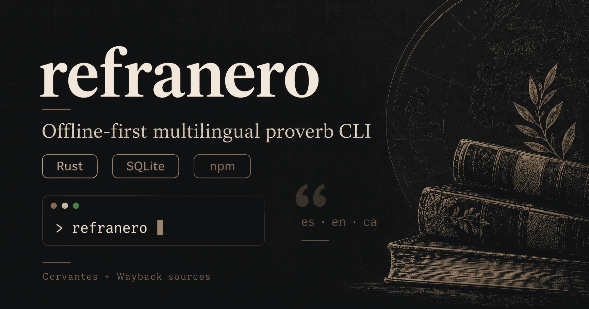

# Refranero (Rust CLI)

[](https://crates.io/crates/refranero-cli)
[](https://www.npmjs.com/package/@yacosta738/refranero)
[](https://hub.docker.com/r/yacosta738/refranero/tags)
[](https://github.com/yacosta738/refranero/releases/latest)
[](https://github.com/yacosta738/refranero/actions/workflows/ci.yml)
[](./LICENSE)

[](https://www.rust-lang.org)
[](https://nodejs.org)
[](https://www.sqlite.org)
[](./Dockerfile)
[](./.github/workflows/release.yml)



Refranero is an offline-first command-line reader for Spanish proverbs
(*refranes*) and related sayings. It reads from a local SQLite catalog. You
can import more entries from the **Biblioteca Virtual Miguel de Cervantes**
and the historical **Centro Virtual Cervantes** index through the
**Wayback Machine**.

## Quick start: get a random refrán

The main use case needs no subcommand and no options. After installing the CLI,
run:

```sh
refranero
```

In a terminal this opens the interactive reader with one random Spanish refrán
from the local catalog. The screen shows the saying, a readable source, its local
entry ID and a source hyperlink. On first use, Refranero creates the SQLite
catalog and seeds it with 16 starter entries.

Add `--plain` to print once and exit. Redirecting the output does the same, so
scripts keep working.

To run it once without a global install, use either npm or pnpm:

```sh
npx --yes @yacosta738/refranero@latest
# Or:
pnpm dlx @yacosta738/refranero@latest
```

Both commands open the same interactive reader, or print once when the output is
redirected. Node.js 18 or newer is required for the npm and pnpm packages.

## Installation options

Choose one installation method. The npm and pnpm packages include a native
executable for supported macOS, Windows, and Linux (glibc) platforms.

### Install globally with npm

```sh
npm install --global @yacosta738/refranero
refranero
```

### Install from crates.io

Rust 1.89 or newer is required to install or build from source.

```sh
cargo install refranero-cli
refranero
```

### Build and run from source

From the repository root, use Cargo to run the CLI without installing it:

```sh
cargo run --
cargo run -- --count 3
cargo run -- --json
cargo run -- --lang en
cargo run -- open
cargo run -- stats
```

### Run the Docker image

```sh
docker run --rm yacosta738/refranero:latest --offline
```

The container displays CLI help when no arguments are provided. Pass
`--offline` to run the default random-refrán command without scheduling a
catalog refresh.

## Interactive reader

When `stdin` and `stdout` are terminals, `refranero` opens a full-screen reader.
The automatic refresh check runs before the reader opens, and its worker keeps
updating the catalog in the background while you read. The reader announces
`Catálogo actualizado` when the new data lands; the entry on screen is not
replaced under you. Use `--offline` to skip the refresh entirely.

While the worker runs, the reader draws a status bar above the key map with the
phase, a block bar, the percentage and the completed units:

```text
  Actualizando Wayback A ███████████░░░░░░░░░░░░░░░░░  40%  4/10
```

| Key | Action |
| --- | --- |
| `n`, `Enter`, `Space` | Next random refrán |
| `l`, `→` | Next language or multilingual variant |
| `h`, `←` | Previous language or variant |
| `c` | Next category |
| `o` | Open the source in the browser |
| `?` | Show or hide the key map |
| `q`, `Esc`, `Ctrl-C` | Quit |

The reader lists the available language codes under the title and boxes the
current one. The caption reads `Otros idiomas` when the codes are translations of
the same entry, and `Idioma` when the entry only exists in one language.

`l` and `h` rotate the translations of the entry on screen and never replace it
with a different refrán. Multilingual variants come from `sync wayback`; the
starter catalog only has one group with Catalan and English translations. When the
entry has no group, the strip keeps its own language visible and `l` reports that
there are no other versions. Use `--lang` to browse another language.

The reader is skipped, and the command prints once, when `stdout` is redirected,
`stdin` is not a terminal, `--json` is set, `--count` is above 1, `--browser` is
set, or `--plain` is passed. Redirected output contains no escape sequences unless
`--color always` is set, so it stays usable in scripts.

## Common use cases

### Get more than one random refrán

The default count is one. `--count` accepts values from 1 to 20.

```sh
refranero --count 3
```

### Choose a category or language

The default category is `refran`, and the default language is Spanish (`es`).
Available category values are `refran`, `paremia`, `proverbio`, `dicho`,
`adivinanza`, and `cita`.

The starter catalog includes `refran`, `proverbio`, and `dicho` entries. To
query another category, import matching entries first. Use `sync virtual` for
current-portal categories or `sync wayback` for historical `paremia` entries.

```sh
refranero --category proverbio --count 3
refranero --category adivinanza
refranero --lang en
refranero --lang ca
```

The result depends on entries in the local catalog. Refranero does not
translate entries automatically. The starter catalog includes Spanish entries
and one English and one Catalan entry.

If the selected language and category have no local entries, the command
reports that no matching entries are available. Import more records with
`import` or `sync` and try again.

### Print JSON

Use `--json` when another program needs to read the random results. The JSON
includes each entry's ID, text, category, language, source, and provenance
fields.

```sh
refranero --json --count 3
```

### Terminal presentation

The default output adapts to the terminal width and respects the reader's theme.
Styles use named ANSI colors only, so the palette configured in the terminal
stays in control.

| Available width | Layout |
| --- | --- |
| 70 columns or more | Editorial: category eyebrow, rule, quote gutter |
| 40–69 columns | Compact: same hierarchy without the rule |
| Fewer than 40 columns | Plain lines with wrapped text |
| Redirected output | Plain text with no escape sequences |

`--count` above one prints a numbered collection instead of repeated cards.
Every entry keeps the same composition, whether you read it with the default
command, `open`, or `--browser`.

Terminal capabilities also change the output:

- Stored text is printed with control characters, terminal escape sequences and
  bidi overrides removed. Stored records are not modified.
- Interactive terminals show `↗ Consultar fuente` as an OSC 8 hyperlink. The
  reader omits a URL wider than the terminal; `o` opens the source. One-shot and
  redirected outputs with hyperlinks disabled print the full URL on its own line,
  never wrapped, so it stays copyable.
- `NO_COLOR` set to a non-empty value disables styling and hyperlinks.
- `--json` never changes: no colors, no headers, no extra characters.

Use `--color` to override the automatic decision:

```sh
refranero --color never    # plain text even in a terminal
refranero --color always   # styles even when redirected
refranero --color auto     # default
```

### Open a source in the browser

Use `--browser` to open the source URL for each randomly selected entry:

```sh
refranero --browser
refranero --browser --count 3
```

Use `open` to open a particular local entry by ID. With no ID, `open` selects
a random entry and opens its source URL. The default is a Spanish refrán;
`--lang` and `--category` can change the selection.

```sh
refranero open 12
refranero open
```

### Inspect the local catalog

`stats` prints the SQLite database path, the total number of entries, and
counts grouped by source, language, and category.

```sh
refranero stats
```

### Use a separate database

By default, the catalog is stored in the operating system's per-user local data
directory under `refranero/catalog.sqlite3`. Use `--db` to select another
SQLite file. The option is available to all commands.

```sh
refranero --db ./catalog.sqlite3 --offline --count 3
refranero --db ./catalog.sqlite3 stats
```

## Import and refresh data

The random command reads local data first. When the interactive reader opens, or
when the catalog is stale, Refranero schedules a background refresh and does not
wait for it. Use `--offline` to skip it and use only the local catalog.

The automatic refresh covers two sources on separate cycles:

- **Cervantes Virtual** (24 hours): replaces the current-portal snapshot.
- **Wayback** (7 days, interactive reader only): imports one archived letter per
  run, advancing A→Z and wrapping around, with a bounded number of root fichas.
  It uses the current year to pick the nearest capture. The job is not scheduled
  for redirected output, so a script never starts a long crawl.

On a fresh catalog the Wayback run is due immediately, so the first interactive
launch may start it. A failed run keeps its letter and retries on the next
interactive launch; closing the reader does not stop a worker that is already
running.

Refresh output is appended to a `catalog.refresh.log` file next to the SQLite
database. While the reader is open, the worker publishes its progress and the
reader draws a status bar with the phase, a block bar, the percentage and the
completed units. The catalog runs in WAL mode when the filesystem supports it;
otherwise readers can wait up to five seconds while the worker commits.

Current-portal entries use the per-entry reference in the page's `blockquote`
`cite` attribute. Refranero validates the host and upgrades HTTP references to
HTTPS. If a page has no safe `cite` value, Refranero falls back to the category
page. The category URL used during import is retained in `original_url`.

When upgrading an existing catalog, Refranero migrates links in the bundled
starter records and marks the current-portal snapshot as stale. Run
`refranero sync virtual --limit 50` once to replace that snapshot immediately
using the same per-page limit as automatic refresh. This replaces prior
`cervantes_virtual` entries but leaves CVC/Wayback records untouched. Otherwise,
the next online random read schedules the refresh in the background.

Only the random command schedules this automatic refresh. `open`, `stats`,
`import` and `sync` do not schedule it. An explicit `sync` command always makes
its own network requests.

### Import a local JSON file

`import` adds validated records from a JSON array. See
[`data/import-example.json`](./data/import-example.json) for the required
fields and format. Optional provenance fields are `original_url`,
`captured_at`, and `group_id`. Imports are idempotent for matching text,
category, language, and source records. A single import file can contain at
most 10,000 records.

```sh
refranero import data/import-example.json
```

### Import current Cervantes Virtual pages

These commands make network requests. Without `--kind`, `sync virtual` fetches
the five supported thematic pages and replaces the current
`cervantes_virtual` snapshot. With `--kind`, it fetches one category and adds
unseen entries. The default limit is 20 per page; the maximum is 50.

```sh
# Refresh all five supported categories.
refranero sync virtual

# Import only one category.
refranero sync virtual --kind refran --limit 20
refranero sync virtual --kind proverbio --limit 20
refranero sync virtual --kind adivinanza --limit 20
```

Supported `--kind` values are `refran`, `proverbio`, `dicho`, `adivinanza`,
and `cita`. `paremia` is a catalog category, but it is not a current-portal
page type.

### Import a historical CVC index through the Wayback Machine

`sync wayback` looks up an archived alphabetical index, imports its Spanish
paremia entries, and follows each archived ficha's language links. For each
linked language with an available HTTP 200 capture, it imports only the primary
`Enunciado` text, not the full ficha. The defaults are letter `A`, year `2020`,
and limit `20`. The letter must be one ASCII letter. The year must be from 1996
through 2100, and the limit must be from 1 through 50.

```sh
refranero sync wayback --letter A --year 2020 --limit 20
refranero --category paremia
```

`--limit` counts unique Spanish root fichas (`Par` IDs), not the total number of
language records. Each language can have its own capture timestamp. A missing
capture is skipped. A transient request or parse failure produces a warning;
the command keeps records it retrieved successfully. Repeating the command is
safe because imports are idempotent. If the Spanish ficha is unavailable, the
Spanish index entry is kept, but the command cannot discover its language links.

`--offline` disables the automatic background refresh for random reads. It
does not turn an explicit `sync` command into an offline operation. `sync`
always requests remote pages.

## Command reference

### Random selection

- `refranero` or `refranero random`: open the interactive reader in a terminal,
  or print random local entries when the output is redirected. The default is one
  Spanish `refran`.
- `--count <N>`: choose 1–20 entries. The default is `1`.
- `--category <CATEGORY>`: filter random results and random `open` selections.
  The default is `refran`.
- `--lang <CODE>`: filter by language code, such as `es`, `en`, or `ca`. The
  default is `es`.
- `--json`: print random results as JSON instead of terminal-friendly text.
- `--color <auto|always|never>`: control ANSI styling. The default is `auto`.
- `--plain`: print once and exit instead of opening the interactive reader.
- `--browser`: open the source URL for each random result. The default is off.
- `--offline`: skip automatic refresh scheduling for random reads. The default
  is off.

### Catalog commands

- `open [ID]`: open an entry by ID, or select and open a random Spanish
  refrán when no ID is given.
- `stats`: show local catalog totals by source, language, and category. This
  command does not make a network request.
- `import <FILE>`: add validated records from a local JSON array. The maximum
  is 10,000 records per file.
- `sync virtual`: import current Cervantes Virtual entries. The default is all
  five pages and 20 entries per page.
- `sync wayback`: import Spanish root entries and available language variants
  from a historical CVC alphabetical index. `--limit` counts unique Spanish
  root fichas. The defaults are letter `A`, year `2020`, and limit `20`.

### General options

- `--db <PATH>`: use a specified SQLite database file. The default is in the
  per-user local data directory.
- `--help` and `--version`: show command help or the installed CLI version.

For all parser-level details, run `refranero --help` or `refranero sync --help`.

## Data and known limitations

- The starter catalog contains 16 entries: 14 Spanish, one English, and one
  Catalan. Other languages depend on imported local data.
- Three Spanish starter entries from the retired CVC Refranero use verified
  Wayback snapshots. The English and Catalan starter entries use active
  references from Idiomingo and PCCD. Their retired CVC URLs remain in
  `original_url` as provenance. The source label identifies the original
  collection; `source_url` is the link opened by the browser. The original CVC
  pages may return 404 because that site has been retired.
- Current Cervantes Virtual imports extract saying text from page blockquotes
  and use each blockquote's validated `cite` reference. They fall back to the
  category page only when the page does not provide a safe reference. The
  citation can open the source work or author portal instead of a standalone
  entry page. The CLI prints the refrán before the browser opens the reference.
- Historical CVC index entries are classified as `paremia` because the index
  includes different subtypes. Historical imports do not extract full ficha
  content; linked language variants contribute only their primary `Enunciado`
  text.
- `sync virtual` is limited to 50 entries per selected page. `sync wayback` is
  limited to 50 unique Spanish root fichas per letter. Each root can add linked
  language variants, so saved records can exceed `--limit`; this limit counts
  root fichas, not network requests. Refranero is not a bulk-crawling tool.
  Respect each site's robots rules, rate limits, and terms.
- Refranero does not deduplicate across different sources because that could
  remove provenance.
- Online imports depend on external sites and their page structures. The old
  CVC Refranero pages are no longer available live; the starter catalog uses
  verified Wayback captures or active reference pages instead.

## Architecture

```text
src/
  main.rs       CLI commands and orchestration
  domain.rs     Category and saying types
  store.rs      Validated SQLite catalog
  ingest.rs     Cervantes Virtual and Wayback import adapters
  refresh.rs    Background refresh policy and Wayback cycle
  session.rs    Interactive reader: terminal lifecycle and key handling
  presentation/ Terminal composition: renderer, screen, theme, labels, sanitization

data/seed.json               Small offline starter catalog
data/import-example.json     Local import format example
npm/wrapper/                 Cross-platform npm launcher
npm/platform/                Native platform package template
scripts/                     Release package preparation
.github/workflows/           CI and release workflows
```

The executable is a native Rust binary. The npm package provides a Node.js
launcher that selects the matching platform package and forwards arguments
and exit codes. It does not download binaries during installation.

The published native package targets are `darwin-arm64`, `darwin-x64`,
`linux-arm64` and `linux-x64` (glibc), `win32-arm64`, and `win32-x64`. Linux
musl is not currently supported.

## Set up the AI agent instructions

The repository guidance for coding agents lives in
[`.agents/AGENTS.md`](.agents/AGENTS.md). Agent tools look for that guidance
under different names, so this repository uses
[AgentSync](https://github.com/dallay/agentsync) to generate the expected
entry points as symlinks. The root `AGENTS.md` is one of those generated
links, and it is not tracked in Git.

Run AgentSync once after a fresh clone to create the links:

```sh
npx --yes @dallay/agentsync@latest apply
```

The command creates the root `AGENTS.md` symlink and the equivalent links for
the other supported tools. It also refreshes the managed block of `.gitignore`
so the generated links stay untracked. Verify the result with:

```sh
npx --yes @dallay/agentsync@latest status
```

A successful run reports `Status: All good`. When AgentSync is already
installed globally, use `agentsync apply` and `agentsync status` instead.

## Releases

Release Please tracks Conventional Commits on `main`. After a release pull
request is approved and merged, it creates a version tag and GitHub Release.
The release workflow publishes the Rust crate to crates.io, the six native
npm packages and npm wrapper with provenance, and multi-architecture images
to Docker Hub and GHCR.

## Data provenance, legal boundaries, and attribution

- [CVC Refranero Multilingüe (Wayback snapshot, 2026-10-11)](https://web.archive.org/web/20261011222412/https://cvc.cervantes.es/lengua/refranero/)
  is separate from the Biblioteca Virtual Miguel de Cervantes.
- [Biblioteca Virtual Miguel de Cervantes — Refranes](https://www.cervantesvirtual.com/portales/refranes_dichos_proverbios_citas_adivinanzas/refran/)
- [Biblioteca Virtual Miguel de Cervantes — Terms](https://www.cervantesvirtual.com/marco-legal/)
- [Idiomingo — He that would learn to pray, let him go to sea](https://idiomingo.com/proverbs/he-that-would-learn-to-pray-let-him-go-to-sea)
- [PCCD — Si vols a Déu pregar, fica't en la mar](https://pccd.dites.cat/p/Si_vols_a_D%C3%A9u_pregar%2C_fica%27t_en_la_mar)
- [Wayback Machine availability API](https://archive.org/wayback/available)

The source code is MIT licensed. That license does **not** cover third-party
page content or compilations. The Biblioteca Virtual Miguel de Cervantes's
terms distinguish personal storage from redistribution and claim protection
of its databases. Historical availability on archive.org does not remove the
original copyright or database rights. **Do not distribute a bulk-harvested
database in an npm package or Git repository without the rightsholder's
authorization.** Refranero includes source references and a small starter
catalog of common sayings. Users are responsible for ensuring that their
private imports comply with applicable terms.
